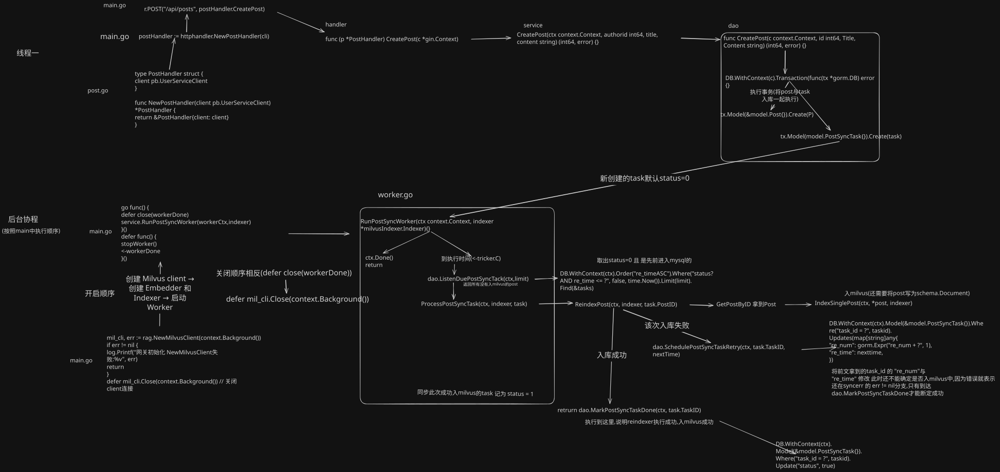
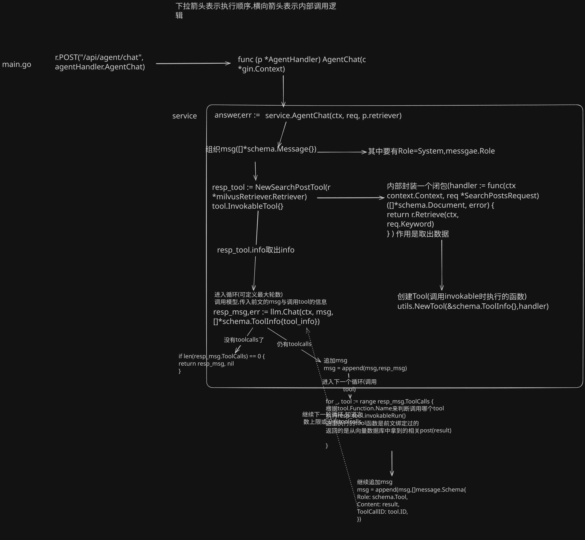

# micro_user
一个基于 gin框架与grpc通信的小型论坛,支持用户登录和发post
站内智能体基于用户问题智能查找相关post并总结内容

项目接入Eino智能体框架,ds智能体(可自己更换密钥或模型),Milvus(向量数据库)实现语义检索
新发布的post通过后台worker写入milvus

## 技术栈

| 技术 | 作用 |
| --- | --- |
| GO | 开发语言 |
| Gin | 开发框架,提供HTTP接口,调用grpc服务 |
| GRPC | 微服务框架,负责网关与用户服务通信 |
| Protobuf | 用于生成代码(可被路由的代码) |
| ORM + mysql | 向数据库中存储数据 |
| milvus | 存储向量数据 |
| golang-JWT | 鉴权中间件 |

## 核心功能

- 用户注册、登录与身份认证
- 创建帖子和查询帖子
- 根据用户问题检索站内帖子并生成回答
- 新帖异步同步至 Milvus，失败后通过 Worker 重试

## 帖子创建与异步同步流程



## Agent 工具调用流程




## 启动前置需求
先在micro_user下创建.env文件 中有以下内容
ARK_API_KEY=火山引擎中的密钥
EMBEDDER=同上,但填的是模型名字,且必须为向量模型
MYSQL_DSN=账号:密码@tcp(127.0.0.1:端口(一般是3306))/数据库名?charset=utf8mb4&parseTime=True&loc=Local

DEEPSEEK_API_KEY= 建议使用deepseek官方密钥,防止msg格式不一
MODEL_LLM=填deepseek模型名称
JWT_SECRET=随便取,启动时会从env中读取


## 启动顺序

启动mysql 且确保已经创建了对应表(env中的MYSQL_DSN)
建表语句见 sql/init.sql    网关启动时会自动创建或迁移 post_sync_tasks 表。
(先进入对应数据库  use 前文DSN中的库名)
建议使用mysql8  

启动docker (需要自行准备docker并启动 Milvus)
启动milvus 可以直接用默认default


cd micro_user (项目根目录)

```powershell
go run ./usersvr
```

打开另一个终端

```powershell
go run ./gateway
```


